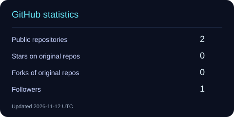
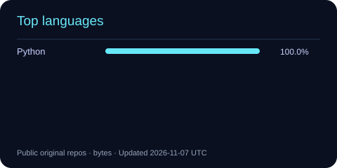

<div align="center">


### Building software that stays calm under load.

<p>
  <a href="https://github.com/Leijingwen?tab=repositories"></a>
  <a href="https://github.com/Leijingwen"></a>
</p>

<p><sub>Backend engineering · distributed systems · continuous learning</sub></p>

</div>

<br />

<table>
<tr>
<td width="55%" valign="top">

## About

I like turning complicated requirements into systems that are easy to reason about, operate, and improve.

My current toolkit sits around **Java**, **SQL**, and the infrastructure that helps products move reliably: messaging, databases, Linux, and developer tooling.

**Never too late to learn.**

</td>
<td width="45%" valign="top">

## At a glance

```text
focus       backend & systems
languages   Java · Python · Scala
data        MySQL · MongoDB · Redis
messaging   Kafka
workflow    Linux · GitHub · Notion
```

</td>
</tr>
</table>

## The stack I reach for

<p>
  
</p>

## Selected signals

<div align="center">
  
  
</div>

<br />

<div align="center">
  
</div>

## Find me here

<p>
  <a href="https://github.com/Leijingwen"></a>
  <a href="https://github.com/Leijingwen?tab=repositories"></a>
</p>

<div align="center">

<sub>Keep shipping. Keep questioning. Keep making the next version better.</sub>

<br />


</div>
